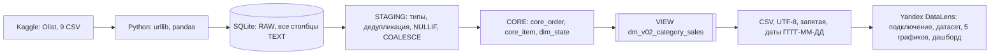
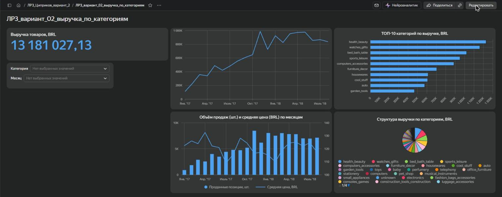
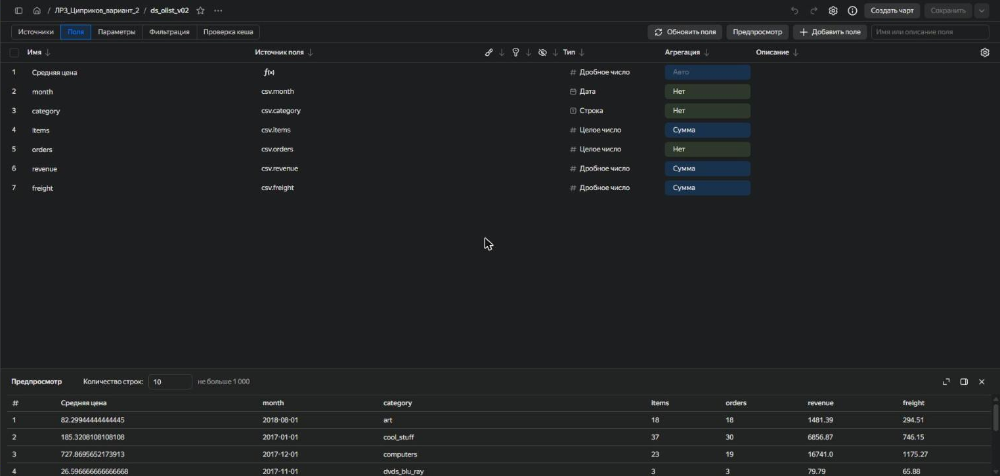
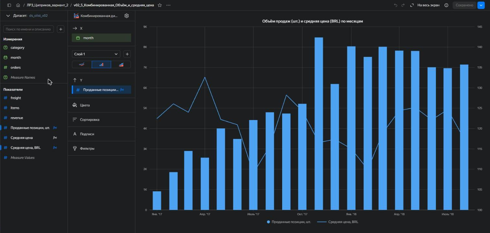

# ЛР-3. Аналитический дашборд для бизнес-кейса — вариант 2

**Студент:** Циприков Д.М. · **группа:** БД-251м
**Бизнес-кейс:** выручка по товарным категориям (маркетплейс Olist, Бразилия)

| Что | Где |
|---|---|
| 📓 Блокнот с решением (выполнен, с выводами ячеек) | [`lab3_student_20_points.ipynb`](lab3_student_20_points.ipynb) |
| 📊 Дашборд DataLens | [ЛР3_вариант_02_выручка_по_категориям]([https://datalens.ru/hu45205rtzcg0-lr3-variant-02-vyruchka-po-kategoriyam](https://datalens.yandex/hu45205rtzcg0?_share_link=public)) |
| 🧾 SQL витрины | [`sql/dm_v02_category_sales.sql`](sql/dm_v02_category_sales.sql) |
| 📖 Словарь полей витрины | [`data/dm_v02_category_sales_dictionary.csv`](data/dm_v02_category_sales_dictionary.csv) |

Блокнот запускается сверху вниз (Google Colab или локальный Jupyter): скачивает Olist, строит слои RAW → STAGING → CORE, создаёт витрину `dm_v02_category_sales`, выгружает CSV для DataLens и проверяет контрольные значения.

## Цель работы
Выяснить, какие товарные категории формируют выручку маркетплейса, как меняется их вклад во времени и какова средняя цена позиции в категории. Результат нужен команде категорийного менеджмента: куда направлять маркетинг и ассортиментные усилия.

## Источники данных
- Набор данных [Brazilian E-Commerce Public Dataset by Olist](https://www.kaggle.com/datasets/olistbr/brazilian-ecommerce): 9 CSV-файлов (заказы, позиции заказов, товары, перевод категорий, клиенты, продавцы, платежи, отзывы, геоданные), 99 441 заказ за 2016–2018 годы.
- Используются таблицы `orders`, `order_items`, `products`, `product_category_name_translation`. Остальные нужны только для построения общего хранилища.
- Исходные CSV, файл `olist_dwh.sqlite` и CSV витрины в репозиторий не загружаются (требование задания).

## Исследуемые метрики
| Метрика | Формула | Где считается |
|---|---|---|
| Выручка, BRL | `SUM(price)` по позициям доставленных заказов, без доставки | витрина, поле `revenue` |
| Проданные позиции, шт. | `COUNT(*)` позиций | витрина, поле `items` |
| Заказы с категорией | `COUNT(DISTINCT order_id)` внутри месяца и категории | витрина, поле `orders` |
| Стоимость доставки, BRL | `SUM(freight_value)` | витрина, поле `freight` |
| Доля категории, % | `revenue категории / revenue всех категорий × 100` | DataLens (круговая диаграмма, «Доля») |
| **Средняя цена, BRL** | `SUM([revenue]) / SUM([items])` | вычисляемое поле DataLens |

Витрина хранит только аддитивные показатели, которые можно суммировать по любым срезам. Среднюю цену нельзя хранить в витрине готовой: среднее по строкам витрины даст «среднее средних» с неверным весом категорий, поэтому она считается в DataLens как отношение сумм.

## Архитектура решения

Слои: `raw_*` (9 таблиц) → `stg_*` (типизация и очистка) → `core_order`, `core_item`, `dim_state` → `dm_v02_category_sales` (VIEW). Стек: Python 3, pandas 2.2.3, SQLite, Jupyter/Google Colab, Yandex DataLens.

## SQL витрины
Файл: [`sql/dm_v02_category_sales.sql`](sql/dm_v02_category_sales.sql). Словарь полей: [`data/dm_v02_category_sales_dictionary.csv`](data/dm_v02_category_sales_dictionary.csv).

**Гранулярность:** одна строка = месяц × категория (1 241 строка, 20 месяцев, 74 категории, дублей ключа нет).

**Источник:** `core_item`, а не `core_order`, потому что категория есть только на уровне позиции заказа; в одном заказе могут быть товары разных категорий.

**Фильтры:**
- `order_status = 'delivered'`: в выручку попадают только доставленные заказы;
- `purchase_month BETWEEN '2017-01-01' AND '2018-08-01'`: только полные месяцы. 2016 год и сентябрь–октябрь 2018 года неполные и искажали бы динамику.

**Поля:** `month` (первый день месяца), `category` (английское название или `unknown`), `items`, `orders`, `revenue`, `freight`.

**Важно:** поле `orders` нельзя суммировать по категориям. Заказ с товарами двух категорий учитывается в каждой из них: сумма по витрине 97 007 против 96 211 уникальных заказов. Для расчётов используются `items` и `revenue`.

## Дашборд DataLens
Ссылка: [ЛР3_вариант_02_выручка_по_категориям](https://datalens.ru/hu45205rtzcg0-lr3-variant-02-vyruchka-po-kategoriyam)

| № | Тип | Название | Поля |
|---|---|---|---|
| 1 | Индикатор | Выручка товаров, BRL | `SUM(revenue)` |
| 2 | Линейная диаграмма | Выручка по месяцам | X: `month`, Y: `SUM(revenue)` |
| 3 | Линейчатая диаграмма | ТОП-10 категорий | Y: `category`, X: `SUM(revenue)`, сортировка по убыванию, фильтр по рангу `RANK_DENSE(SUM([revenue]), "desc")` ≤ 10 |
| 4 | Круговая диаграмма | Структура выручки | Цвета: `category`, показатель: `SUM(revenue)` |
| 5 | Комбинированная диаграмма | Объём и средняя цена | X: `month`; слой 1 (столбцы): `SUM(items)`; слой 2 (линия): `Средняя цена` |

Селекторы: **Категория** и **Месяц** (оба с множественным выбором); действуют на все пять графиков.

### Как устроено внутри

В датасете `ds_olist_v02` аддитивные поля (`items`, `revenue`, `freight`) агрегируются суммой, `orders` не агрегируется (его нельзя суммировать по категориям), а `Средняя цена` задана вычисляемым полем.

Пример настройки чарта: комбинированная диаграмма (слой 1 — столбцы `Проданные позиции, шт.`, слой 2 — линия `Средняя цена, BRL` на правой оси).

## Выводы и бизнес-рекомендации
1. **Выручка сосредоточена в нескольких категориях, но «длинный хвост» велик.** Всего 13,18 млн BRL по 74 категориям; ТОП-5 даёт 39,8 %, ТОП-10 — 62,5 %. Лидер `health_beauty` (1,23 млн BRL, 9,3 %), следом `watches_gifts` (8,8 %) и `bed_bath_table` (7,8 %). Ни одна категория не превышает 10 %, зависимость от одной категории низкая.
2. **Выручку определяет не только объём, но и средний чек позиции.** `bed_bath_table` продаёт больше всех позиций (10 945 шт.), но по выручке только третья, потому что средняя цена 93,5 BRL. `watches_gifts` продаёт почти вдвое меньше штук (5 855), но стоит 198,7 BRL за позицию и занимает второе место. `cool_stuff` с 3 711 штук и ценой 164,1 BRL входит в ТОП-8.
3. **Доли категорий смещаются в сторону дорогих.** Сравнение января–августа 2018 года с тем же периодом 2017 года: выручка выросла на 141 % (с 2,99 до 7,22 млн BRL), доля `health_beauty` — с 8,1 до 10,5 %, `watches_gifts` — с 6,7 до 9,5 %, а доля `bed_bath_table` упала с 8,5 до 7,4 %, и из лидеров она ушла на третье место.
4. **Сезонный пик ноября.** В ноябре 2017 года выручка 987,8 тыс. BRL, на 52 % больше октября (648,2 тыс.) и выше любого месяца 2018 года, а в декабре она упала на 26 %. С июня по август 2018 года выручка держится на уровне около 0,85 млн BRL против 0,93 млн BRL в среднем за январь–май 2018 года.

**Рекомендации.**
- Расширять ассортимент и усиливать продвижение в `health_beauty` и `watches_gifts`: их выручка растёт быстрее маркетплейса в целом (+210 % и +242 % против +141 % в январе–августе 2018 к 2017 году) и они дают высокий чек (130,5 и 198,7 BRL за позицию).
- Для `bed_bath_table` и `furniture_decor` (87,2 BRL) искать рост через средний чек (комплекты, допродажи), а не только через объём.
- Планировать запасы и рекламный бюджет под ноябрьский пик: готовить предложения в октябре, а в декабре не рассчитывать на сохранение ноябрьского уровня.

## Ограничения
- Учтены только заказы со статусом `delivered` в окне январь 2017 — август 2018. Из выручки позиций исключено 2 770 позиций на 410 616,57 BRL (3,0 % общей выручки): 2 453 позиции в других статусах (отменены, в пути и т. д.) и 317 доставленных позиций 2016 года.
- Для последних месяцев окна часть заказов могла быть ещё не доставлена на момент выгрузки (в августе 2018 года 106 позиций в статусах `canceled`, `invoiced`, `shipped`), поэтому спад июня–августа 2018 года нужно проверять на более свежих данных.
- Выручка в номинальных BRL без пересчёта на инфляцию; возвраты после доставки в данных не отражены; доставка в выручку не входит.
- У 1,3 % выручки (1 535 позиций, 170,7 тыс. BRL) категория неизвестна (`unknown`): у части товаров в исходных данных пустое название категории.
- Категория закреплена за товаром статично, историю смены категории набор данных не хранит.
- Датасет Olist — выборка одного маркетплейса за два года, переносить выводы на весь рынок Бразилии нельзя.
- Рост 2018 года к 2017-му отчасти отражает рост самого маркетплейса, а не только спрос на категории: выводы о долях надёжнее выводов об абсолютных значениях.
